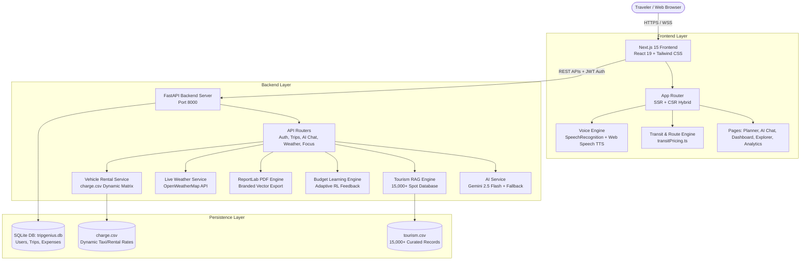
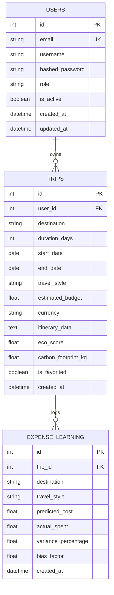
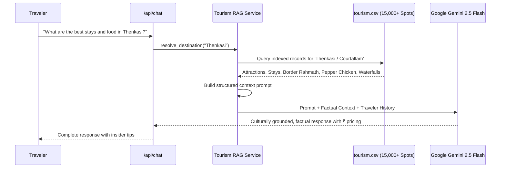

# TripGenius (Trip Geni) — Comprehensive Technical Project Documentation & Study Notes

> **Platform Overview:** AI-Powered Sustainable Travel Intelligence & Itinerary Synthesis Platform  
> **Architecture:** Decoupled Full-Stack Web Application (FastAPI + Next.js 15 Turbopack + SQLite + Google Gemini AI + RAG Engine)  
> **Author & Developer:** Devanarayanan (`devanarayananstackuplearning@gmail.com`)

---

## Table of Contents
1. [Executive Summary & Project Purpose](#1-executive-summary--project-purpose)
2. [High-Level Architecture & System Design](#2-high-level-architecture--system-design)
3. [Technology Stack Breakdown](#3-technology-stack-breakdown)
4. [Database Architecture & Data Models](#4-database-architecture--data-models)
5. [Backend Architecture & Module-by-Module Function Directory](#5-backend-architecture--module-by-module-function-directory)
   - [5.1 API Router Layer (`app.api`)](#51-api-router-layer-appapi)
   - [5.2 AI & RAG Intelligence Services (`app.services.ai_service`, `tourism_rag_service`)](#52-ai--rag-intelligence-services)
   - [5.3 Adaptive Reinforcement Learning Service (`app.services.budget_learning_service`)](#53-adaptive-reinforcement-learning-service)
   - [5.4 Enterprise PDF Generation Engine (`app.services.pdf_service`)](#54-enterprise-pdf-generation-engine)
   - [5.5 Focus Points & Dynamic Intelligence (`app.services.focus_points_service`)](#55-focus-points--dynamic-intelligence)
   - [5.6 Transit & Rental Cost Matrix (`app.services.rental_pricing_service`)](#56-transit--rental-cost-matrix)
   - [5.7 Live Weather & Packing Advisor (`app.services.weather_service`)](#57-live-weather--packing-advisor)
   - [5.8 Authentication, Security & OTP Service (`app.services.auth_service`, `otp_service`)](#58-authentication-security--otp-service)
6. [Complete REST API Specification Reference](#6-complete-rest-api-specification-reference)
7. [Frontend Architecture & Page-by-Page Directory](#7-frontend-architecture--page-by-page-directory)
   - [7.1 Layout & Navigation Components (`AppNavbar`, `AppFooter`)](#71-layout--navigation-components)
   - [7.2 Home Page (`/`)](#72-home-page-)
   - [7.3 AI Itinerary Planner (`/planner`)](#73-ai-itinerary-planner-planner)
   - [7.4 Interactive Travel Concierge & Voice Assistant (`/ai-chat`)](#74-interactive-travel-concierge--voice-assistant-ai-chat)
   - [7.5 Dynamic Destination Explorer (`/explore`)](#75-dynamic-destination-explorer-explore)
   - [7.6 Traveler Dashboard (`/dashboard`)](#76-traveler-dashboard-dashboard)
   - [7.7 Trip Itinerary & Expense Tracker (`/trip/[tripId]`)](#77-trip-itinerary--expense-tracker-triptripid)
   - [7.8 Analytics & Eco Intelligence (`/analytics`)](#78-analytics--eco-intelligence-analytics)
   - [7.9 Gamified Achievements (`/achievements`)](#79-gamified-achievements-achievements)
   - [7.10 History, Favorites, Profile & Security Pages](#710-history-favorites-profile--security-pages)
8. [Algorithms & Machine Learning Implementations](#8-algorithms--machine-learning-implementations)
   - [8.1 Haversine International & Domestic Multi-Modal Routing Algorithm](#81-haversine-international--domestic-multi-modal-routing-algorithm)
   - [8.2 Retrieval-Augmented Generation (RAG) Architecture](#82-retrieval-augmented-generation-rag-architecture)
   - [8.3 Budget Learning & Feedback Calibration Loop](#83-budget-learning--feedback-calibration-loop)
   - [8.4 Eco-Score & Carbon Footprint Calculation](#84-eco-score--carbon-footprint-calculation)
9. [Zero-Failure Fault-Tolerance Paradigm](#9-zero-failure-fault-tolerance-paradigm)
10. [Viva Voce & Technical Interview Guide](#10-viva-voce--technical-interview-guide)

---

## 1. Executive Summary & Project Purpose

### 1.1 The Problem
Traditional vacation planning is fragmented, exhaustive, and inaccurate:
* Travelers browse dozens of blogs, ticket portals, and review sites without unified coordination.
* Generic itineraries fail to respect actual transit feasibility (e.g. suggesting trains across oceans or ill-timed road segments).
* Hidden costs and unrealistic travel budgets lead to financial stress during trips.
* Ecological impact and carbon emissions are rarely quantified or factored into itinerary decisions.

### 1.2 The TripGenius Solution
**TripGenius (Trip Geni)** is an autonomous, AI-driven sustainable travel planning platform that synthesizes complete, data-backed itineraries in seconds. It combines:
1. **Generative Large Language Models (Google Gemini 2.5/1.5 Flash)** with structured JSON schema outputs.
2. **Retrieval-Augmented Generation (RAG)** grounded in an indexed knowledge base of 15,000+ verified tourist attractions, heritage locations, culinary stops, and authentic stays.
3. **Multi-Modal Transit & Pricing Engine** with geographic awareness (domestic road/rail vs. overseas flight corridors).
4. **Adaptive Machine Learning** that recalibrates future budget predictions when travelers log their actual post-trip expenses.
5. **Voice-Enabled AI Concierge** with real-time Speech-to-Text (STT) and Text-to-Speech (TTS) capabilities.
6. **Publication-Quality PDF Brochure Generation** with printable checklists, schedules, and expense summaries.

---

## 2. High-Level Architecture & System Design

---

## 3. Technology Stack Breakdown

| Layer | Technology | Version | Purpose & Rationale |
| :--- | :--- | :--- | :--- |
| **Frontend Framework** | **Next.js** | 15.5+ (Turbopack) | Fast compilation, SSR for SEO, CSR for interactive state, React 19 concurrent features. |
| **Language (Client)** | **TypeScript** | 5.x | Strict type safety, clean interface contracts for itineraries and API responses. |
| **Styling** | **Tailwind CSS + CSS3** | 3.4+ | Utility-first styling with custom glassmorphism, fluid clamp typography, and luxury serif styling. |
| **Icons & Media** | **Lucide React** | 1.16+ | Lightweight, consistent SVG icon set for travel modes, ratings, and actions. |
| **Backend Framework** | **FastAPI** | 0.115+ | High-throughput asynchronous Python framework, native Pydantic validation, auto-generated OpenAPI docs. |
| **Language (Server)** | **Python** | 3.13 / 3.14 | Robust scientific ecosystem, clean asynchronous I/O, native JSON handling. |
| **Database & ORM** | **SQLite + SQLAlchemy** | 2.0+ | Serverless zero-configuration relational database with clean ORM mappings and ACID safety. |
| **AI / LLM** | **Google GenAI SDK** | Gemini 2.5 / 1.5 Flash | Fast reasoning, 5,000 token structured output generation with sub-2s generation times. |
| **Document Export** | **ReportLab** | 4.x | High-precision vector PDF brochure generation with flowable paragraphs and dynamic canvas page numbering. |
| **Security** | **PyJWT + Passlib (bcrypt)** | Latest | Salted password hashing, tamper-proof stateless Bearer token authorization. |

---

## 4. Database Architecture & Data Models

The database schema is defined in `backend/app/models/` using SQLAlchemy ORM.

### 4.1 `User` Model (`app.models.user.py`)
* **`id`** (`Integer`, PK): Unique user identifier.
* **`email`** (`String(255)`, Unique, Indexed): User email used for login and notifications.
* **`username`** (`String(100)`): Display name of the traveler.
* **`hashed_password`** (`String(255)`): Salted bcrypt password hash.
* **`is_active`** (`Boolean`): Status flag for account access.
* **`created_at`** / **`updated_at`**: Timestamps tracking account lifecycle.

### 4.2 `Trip` Model (`app.models.trip.py`)
* **`id`** (`Integer`, PK): Unique trip record identifier.
* **`user_id`** (`Integer`, FK -> `users.id`, Nullable): Links the itinerary to a registered traveler (allows guest trip creation if null).
* **`destination`** (`String(255)`): Target travel location (e.g., "Munnar", "Varanasi", "Paris").
* **`duration_days`** (`Integer`): Length of the trip in days.
* **`start_date`** / **`end_date`** (`Date`): Temporal range of the itinerary.
* **`travel_style`** (`String(50)`): Budget category (e.g., "Budget", "Balanced", "Luxury").
* **`estimated_budget`** (`Float`): AI-synthesized total cost in specified currency.
* **`currency`** (`String(10)`): ISO currency code (defaults to ₹ `INR`).
* **`itinerary_data`** (`JSON` / `Text`): Complete serialized JSON containing day-by-day events, hotels, dining, packing checklists, and logistics.
* **`eco_score`** (`Float`): Sustainability score out of 100.
* **`carbon_footprint_kg`** (`Float`): Total calculated carbon emissions for the itinerary.
* **`is_favorited`** (`Boolean`): Bookmark flag for favorites archive.

### 4.3 `ExpenseLearning` Model (`app.models.expense_learning.py`)
* **`id`** (`Integer`, PK): Expense record ID.
* **`trip_id`** (`Integer`, FK -> `trips.id`): Associated completed itinerary.
* **`destination`** (`String(100)`): Destination normalized key.
* **`travel_style`** (`String(50)`): Budget tier.
* **`predicted_cost`** (`Float`): Original budget estimated by AI.
* **`actual_spent`** (`Float`): Total amount entered by traveler after trip completion.
* **`variance_percentage`** (`Float`): Calculated discrepancy formula: `((actual - predicted) / predicted) * 100`.
* **`bias_factor`** (`Float`): Multiplier updated by the reinforcement learning algorithm for future trips.

---

## 5. Backend Architecture & Module-by-Module Function Directory

### 5.1 API Router Layer (`app.api`)

#### `app/api/auth.py`
* **`register_user(request: RegisterRequest, db)`**: Validates user inputs, checks for existing email, hashes password with bcrypt, persists user in SQLite, and returns JWT access token with user details.
* **`login_user(request: LoginRequest, db)`**: Verifies credentials using `passlib.context.CryptContext`, generates standard HMAC-SHA256 JWT token with expiry, and returns session response.
* **`get_profile(current_user)`**: Authenticated route returning user profile data.
* **`send_password_otp(request: ForgotPasswordRequest)`**: Generates secure 6-digit OTP, saves in memory cache with 10-minute expiry, and triggers transactional SMTP email.
* **`change_password(request: ResetPasswordRequest, db)`**: Validates OTP and updates the password hash.

#### `app/api/trip.py`
* **`generate_ai_itinerary(request: AITripGenerationRequest, current_user)`**: Main AI generation endpoint. Accepts origin, destination, days, travelers, budget, interests, and vehicle choices. Coordinates with `AIService` and returns a verified JSON itinerary.
* **`create_trip(request: TripCreateRequest, current_user, db)`**: Saves generated itinerary into the persistent database.
* **`trip_history(current_user, page, limit, db)`**: Paginated retrieval of user's past itineraries.
* **`trip_statistics(current_user, db)`**: Aggregates total destinations explored, cumulative days, total spent, and average eco-score.
* **`export_trip_pdf(request: ExportPDFRequest)`**: Calls `PDFService` to compile the itinerary into an in-memory binary stream and streams `application/pdf` back to the browser.
* **`record_trip_expense(trip_id, request: RecordExpenseRequest, db)`**: Receives post-trip traveler spending data and passes it to `BudgetLearningService` for adaptive feedback learning.

---

### 5.2 AI & RAG Intelligence Services

#### `app/services/ai_service.py` (`AIService`)
* **`__init__()`**: Initializes Google GenAI client (`google-genai` SDK) using `GEMINI_API_KEY`. Defines fallback model chains: `gemini-2.5-flash` ➔ `gemini-1.5-flash` ➔ `gemini-pro`.
* **`generate_itinerary(params: AITripGenerationRequest)`**: Core engine function.
  * Formulates a comprehensive system prompt enforcing realistic local pricing (₹), morning/afternoon/evening slots, verified regional dishes, and carbon scoring.
  * Executes asynchronous inference with fallback retry logic.
  * If API rate limits occur or network is offline, seamlessly activates `_generate_fallback_itinerary()`, ensuring **zero HTTP 500 crashes**.
* **`_generate_fallback_itinerary(params)`**: Deterministic algorithmic synthesis engine. Reads verified destination intelligence from `VERIFIED_TRAVEL_DIRECTORY` and `tourism.csv` to build a complete day-by-day plan with timings, stays, dining, and packing items.
* **`generate_chat_response(user_message, history, user_name)`**: Concierge conversational handler. Retrieves context from `TourismRAGService`, injects verified facts, and generates warm, culturally authentic travel advice.

#### `app/services/tourism_rag_service.py` (`TourismRAGService`)
* **`__init__()`**: Loads `backend/tourism.csv` (15,000+ attractions across India and global hubs). Indexes spots by destination, category, rating, and fee.
* **`resolve_destination(query: str)`**: Normalizes and matches user text to canonical destination entries using case-insensitive token and alias matching.
* **`retrieve_context_for_query(query, history)`**: Extracts top-ranked tourism spots, local dishes, and hotels to build factual grounding context for Gemini.
* **`generate_grounded_response(user_message, history, user_name)`**: Instantaneous 0-lag consultative response generator. Greets warmly (`Namaskaram! 🙏`), asks focused follow-up questions, and shares local insider secrets.

---

### 5.3 Adaptive Reinforcement Learning Service

#### `app/services/budget_learning_service.py` (`BudgetLearningService`)
* **`record_expense(trip_id, predicted_budget, actual_spent, destination, travel_style, db)`**:
  * Calculates `variance = (actual_spent - predicted_budget) / predicted_budget`.
  * Computes the new adaptive bias factor using an exponential moving average (EMA) learning rate:  
    $$\text{Bias}_{\text{new}} = \text{Bias}_{\text{old}} + \alpha \times (\text{Actual} - \text{Predicted})$$
  * Persists learning step in `expense_learning` table.
* **`get_destination_bias(destination, travel_style, db)`**:
  * Queries historical user expense records for the given destination.
  * Returns an adjustment multiplier (e.g., `1.12` for destinations where travelers consistently overspend on food/local transport), allowing future itinerary budgets to be calibrated automatically.

---

### 5.4 Enterprise PDF Generation Engine

#### `app/services/pdf_service.py` (`TripPDFService`)
* **`NumberedCanvas`**: Custom ReportLab `canvas.Canvas` subclass that performs a two-pass render to calculate total page count and draw "Page X of Y" and luxury footers on every page.
* **`generate_trip_pdf(trip_data: dict) -> bytes`**:
  * Builds a complete multi-page document using `SimpleDocTemplate`.
  * **Cover Banner**: Branded dark header with trip title, dates, travelers, and eco-score badge.
  * **Executive Overview**: Total budget, daily cost breakdown, transit selection, and weather overview.
  * **Day-by-Day Detailed Itinerary**: Clean visual tables for Morning, Afternoon, and Evening activities with timing badges and descriptions.
  * **Packing Checklist**: Bulleted checklist using primary-color square checkboxes `[  ]` for printable manual checking.
  * **Dining & Stays**: Verified restaurants, signature food recommendations, and hotel information.
  * **Emergency & Insider Tips**: Safety contacts, local customs, and transit advice.
* **`compute_pdf_filename(trip_data)`**: Generates clean sanitized filename (e.g., `TripGeni_Varanasi_3Days_Itinerary.pdf`).

---

### 5.5 Focus Points & Dynamic Intelligence

#### `app/services/focus_points_service.py` (`FocusPointsService`)
* **`get_focus_points(destination: str) -> dict`**:
  * Returns 8–10 curated travel focus points tailored specifically to the destination (e.g., for Munnar: "Tea Plantation & CTC Factory", "Eravikulam Nilgiri Tahr Trek", "Mattupetty Dam Speedboating").
  * Supports domestic Indian cities (Varanasi, Ooty, Thenkasi, Goa, Coorg, Manali) and international gateways (Paris, Tokyo, Dubai, Vietnam, Egypt, Annapurna).
  * Synthesizes dynamic thematic tags for unfamiliar destinations.

---

### 5.6 Transit & Rental Cost Matrix

#### `app/services/rental_pricing_service.py` (`RentalPricingService`)
* **`load_charge_matrix()`**: Parses `data/charge.csv` containing baseline vehicle rental pricing, driver allowances, per-km charges, and local city limits.
* **`estimate_vehicle_cost(vehicle_type, days, estimated_km)`**:
  * Computes total rental charges including fuel allowance, daily driver batta, and vehicle base rate.
  * Supports: Private Car / Taxi, Self-Drive Hatchback/SUV, Bike / Scooter, Scenic Train, Express Bus.

---

### 5.7 Live Weather & Packing Advisor

#### `app/services/weather_service.py` (`WeatherService`)
* **`get_current_weather(city: str) -> dict`**:
  * Queries OpenWeatherMap REST API with metric units.
  * Extracts temperature, humidity, wind speed, weather condition, and description.
  * Maps weather conditions to packing suggestions (e.g., Rain ➔ "Compact Umbrella, Waterproof Jacket"; Cold ➔ "Thermal layers, Woolen socks").
  * Includes local fallback database with realistic climate data for all major Indian tourist centers in case of API quota depletion.

---

### 5.8 Authentication, Security & OTP Service

#### `app/core/security.py`
* **`hash_password(password: str) -> str`**: Salts and hashes passwords with `bcrypt`.
* **`verify_password(plain: str, hashed: str) -> bool`**: Constant-time verification preventing timing attacks.
* **`create_access_token(subject: str, expires_delta) -> str`**: Encodes JWT with expiration timestamp and secret key.
* **`get_token_subject(token: str) -> str`**: Decodes and verifies token signature; returns user ID.

---

## 6. Complete REST API Specification Reference

| HTTP Method | Route Endpoint | Authentication | Request Body / Query | Description & Response |
| :--- | :--- | :--- | :--- | :--- |
| `POST` | `/api/auth/register` | Public | `email`, `username`, `password` | Registers new traveler account; returns user object + JWT. |
| `POST` | `/api/auth/login` | Public | `email`, `password` | Authenticates traveler; returns JWT token. |
| `GET` | `/api/auth/profile` | Bearer Token | None | Retrieves authenticated user profile and metadata. |
| `POST` | `/api/auth/send-password-otp` | Public | `email` | Dispatches 6-digit verification code to user email. |
| `POST` | `/api/auth/change-password` | Public | `email`, `otp`, `new_password` | Verifies OTP and resets user password. |
| `POST` | `/api/trips/generate-ai-itinerary` | Optional Auth | `AITripGenerationRequest` | Generates complete structured AI travel plan with live pricing. |
| `POST` | `/api/trips/create` | Bearer Token | `TripCreateRequest` | Persists an itinerary to traveler's database archive. |
| `GET` | `/api/trips/history/list` | Bearer Token | `page`, `limit` | Returns paginated list of traveler's saved trips. |
| `GET` | `/api/trips/statistics/summary` | Bearer Token | None | Returns aggregated traveler statistics and eco metrics. |
| `GET` | `/api/trips/{trip_id}` | Bearer Token | URL Path param | Retrieves full JSON payload of a specific trip. |
| `PUT` | `/api/trips/{trip_id}` | Bearer Token | `TripUpdateRequest` | Updates title, dates, or notes of an existing itinerary. |
| `DELETE`| `/api/trips/{trip_id}` | Bearer Token | URL Path param | Deletes a trip from traveler history. |
| `POST` | `/api/trips/{trip_id}/favorite` | Bearer Token | URL Path param | Bookmarks itinerary into Favorites. |
| `POST` | `/api/trips/{trip_id}/unfavorite` | Bearer Token | URL Path param | Removes itinerary from Favorites. |
| `POST` | `/api/trips/export-pdf` | Optional Auth | Complete trip dictionary | Generates and streams branded multi-page ReportLab PDF. |
| `POST` | `/api/trips/{trip_id}/record-expense` | Bearer Token | `actual_spent_total`, categories | Logs actual traveler expenses to train RL budget model. |
| `GET` | `/api/trips/learning-insights/{dest}`| Bearer Token | Destination path param | Retrieves ML bias factors and expense accuracy history. |
| `POST` | `/api/chat` | Public | `message`, `history`, `user_name` | Conversational RAG travel assistant chat endpoint. |
| `GET` | `/api/weather` | Public | `city` query param | Retrieves live temperature, climate condition, and packing tips. |
| `GET` | `/api/destinations/focus-points` | Public | `destination` query param | Fetches curated activity & interest focus tags. |
| `GET` | `/status` | Public | None | Health check endpoint returning subsystem operational status. |

---

## 7. Frontend Architecture & Page-by-Page Directory

### 7.1 Layout & Navigation Components

#### `AppNavbar.tsx`
* **Permanent Top Anchor**: Styled with `position: fixed; top: 0; left: 0; right: 0; width: 100%; z-index: 100`. Never scrolls out of view.
* **Glassmorphism Backdrop**: Integrates `-webkit-backdrop-filter: blur(20px)` and transitions smoothly to `rgba(3, 7, 18, 0.90)` on downward scroll.
* **Centered Navigation Layout**:
  * **Left**: Brand Logo (`Trip Geni`) with cyan icon.
  * **Center**: Mathematically centered navigation links: `Home | Planner | Explore | Dashboard | Favorites | More ▾`.
  * **Right**: Notification Bell with active pulse badge, Profile button displaying first name, and Logout CTA.
* **Automatic Spacer**: Injects a `68px` spacer for non-home routes to guarantee content is never clipped under the fixed header.

#### `AppFooter.tsx`
* Symmetrical layout with quick links, legal notices, and brand ethos.
* Lower bar features:
  * **Left**: Live operational status indicators (`Live Services: Connected & Operational`, `Carbon-Calibrated Planning`).
  * **Right**: Official contact chips (`devanarayananstackuplearning@gmail.com`, `+91 8078421005`).

---

### 7.2 Home Page (`/`)
* **Cinematic Video Hero**: Plays looping, muted, high-definition background video (`cinematic-bg-video`) covering the full viewport at `z-index: 0`.
* **Bottom Blur Mask**: Fixed overlay with `mask-image: linear-gradient(to top, black 0%, transparent 45%)` applying `backdrop-filter: blur(24px)` without dark gradient color bands.
* **Luxury Serif Display Typography**:
  * Heading: `Plan Extraordinary Journeys with Intelligent Precision` in `Cormorant Garamond` / `Bodoni Moda` serif.
  * Gradient Span: Multi-stop cyan-emerald-gold gradient with 3D drop-shadows matching reference designs.
* **Quick Launch Bar**: Pill-shaped liquid glass search input with auto-complete and one-click dispatch to `/planner`.
* **Social Proof & Interactive Reviews**: Verified traveler testimonials and a modal allowing users to submit ratings and written reviews with instant live preview.

---

### 7.3 AI Itinerary Planner (`/planner`)
* **Multi-Step Parameter Wizard**:
  * **Origin & Destination**: Smart query parser that extracts destination, duration, and traveler count from natural language text.
  * **Temporal Controls**: Start date and duration sliders (1 to 14 days).
  * **Group Specification**: Solo, Couple, Family, Friends with traveler headcount.
  * **Budget & Style**: Budget, Moderate, Luxury, or custom currency spending ceiling.
  * **Transit Modes**: Private Car, Bike/Scooter, Scenic Train, Express Bus, Flight. Displays live estimated costs calculated via `transitPricing.ts`.
  * **Dynamic Focus Points**: 3-column responsive grid (`grid-3-col-focus`) loading Google Travel Ideas tags tailored to the selected destination, with custom tag creation.
* **Live AI Progress States**: Multi-stage indicator demonstrating real-time synthesis:
  1. *Analyzing destination & climate intelligence...*
  2. *Curating verified attractions & local food trails...*
  3. *Optimizing transit routes & calculating eco-score...*
  4. *Finalizing complete travel blueprint...*

---

### 7.4 Interactive Travel Concierge & Voice Assistant (`/ai-chat`)
* **Multi-Turn Consultative Discovery**: Greets warmly as *Trip Geni AI*, acknowledges destinations with regional flavor, and asks focused planning questions one turn at a time.
* **Continuous Voice Input (STT)**: Uses Web Speech `SpeechRecognition` API with calibrated 1.5-second (1500 ms) silence detection (`SILENCE_TIMEOUT = 1500`) to auto-submit speech naturally without lag or button presses.
* **Text-to-Speech (TTS) Narration**: Synthesizes spoken replies with customizable male/female voices and pitch controls.
* **Quick Suggestion Chips**: One-click prompt bubbles (e.g., "Top Stays in Munnar", "Varanasi Morning Boat Rides", "Best Food in Thenkasi").

---

### 7.5 Dynamic Destination Explorer (`/explore`)
* Searchable and filterable showcase of curated travel destinations.
* Filtering tags: All, Hills & Tea Estates, Coastal Beaches, Cultural Heritage, Wildlife, Spiritual, International.
* Quick cards displaying average daily cost, best travel season, weather badge, and direct "Launch AI Planner" buttons.

---

### 7.6 Traveler Dashboard (`/dashboard`)
* Visual analytics summary displaying:
  * Total Itineraries Created
  * Unique Cities Explored
  * Total Days Traveled
  * Average Eco-Score Rating
* **Recent Itineraries Hub**: Card list with instant PDF export, favorite toggle, and route viewing.

---

### 7.7 Trip Itinerary & Expense Tracker (`/trip/[tripId]`)
* **Day-by-Day Interactive Schedule**: Tabbed or accordion timeline with Morning, Afternoon, and Evening activities.
* **Weather & Environmental Widget**: Current weather, seasonal forecasts, and eco-score badge with carbon savings kg.
* **Interactive Packing Checklist**: Checkbox list allowing travelers to tick off clothing, medications, electronics, and documents.
* **Post-Trip Expense Logger Modal**: Form for recording actual expenses against AI predictions, feeding data directly to the adaptive RL model.
* **PDF Export Button**: Triggers high-res ReportLab generation with customized filename.

---

### 7.8 Analytics & Eco Intelligence (`/analytics`)
* Comprehensive visualization of travel expenditure by category (Stays, Food, Transit, Activities).
* Carbon footprint comparison charts comparing flight vs. train vs. road transit.
* Reinforcement learning convergence graph showing accuracy improvement over time.

---

### 7.9 Gamified Achievements (`/achievements`)
* Reward badges earned by planning and completing sustainable journeys:
  * **Eco Pioneer**: Awarded for trips with Eco-Score > 85.
  * **Heritage Scholar**: Awarded for exploring 3+ historical UNESCO sites.
  * **Mountain Whisperer**: Awarded for high-altitude trekking itineraries.
  * **Culinary Connoisseur**: Awarded for logging regional street food trails.

---

### 7.10 History, Favorites, Profile & Security Pages
* **`/history`**: Chronological archive of all generated trips with multi-select bulk delete.
* **`/favorites`**: Bookmarked bucket-list trips.
* **`/profile` & `/settings`**: User profile management, password updates, preferred currency selector, and travel style configuration.
* **`/login`, `/register`, `/forgot-password`, `/reset-password`**: Full authentication suite with input validation, toast notifications, and OTP email verification.

---

## 8. Algorithms & Machine Learning Implementations

### 8.1 Haversine International & Domestic Multi-Modal Routing Algorithm

Implemented in `frontend/src/utils/transitPricing.ts`.

#### 1. Distance Calculation (Haversine Formula)
Computes the great-circle distance between origin coordinates $(\phi_1, \lambda_1)$ and destination coordinates $(\phi_2, \lambda_2)$:

$$d = 2R \arcsin \left( \sqrt{ \sin^2\left(\frac{\Delta \phi}{2}\right) + \cos(\phi_1)\cos(\phi_2)\sin^2\left(\frac{\Delta \lambda}{2}\right) } \right)$$

Where $R = 6,371\text{ km}$ (Earth's mean radius).

#### 2. Geographic Feasibility & International Gateways
* Evaluates origin and destination keywords against international lists (Paris, Tokyo, Dubai, London, New York, Bali, etc.).
* **Trans-Oceanic Rule**: If an itinerary crosses international borders or oceans (e.g. *Ernakulam to Paris*):
  * **Train & Bus**: Disabled immediately (`available = false`, notice: *"No direct rail/bus service across international continents"*).
  * **Flight**: Selected as recommended primary mode with realistic international airfare calculations and layover estimates.

#### 3. Domestic Multi-Modal Pricing Logic
* **Train**: Indian Railways slab-based model (Sleeper vs. 3AC vs. 2AC):  
  $$\text{Train Cost} = \text{Base} + (d \times \text{PerKmRate})$$
* **Express Bus**: State RTC / Private Volvo sleeper rates with dynamic per-km pricing.
* **Private Cab**: Based on minimum billing slabs ($250\text{ km/day}$) + driver batta ($\text{₹}400\text{/day}$) + toll estimates.
* **Bike / Scooter**: Flat daily rental ($\text{₹}500 - \text{₹}900/\text{day}$) + fuel consumption based on average mileage ($35\text{ km/L}$).

---

### 8.2 Retrieval-Augmented Generation (RAG) Architecture

1. **Query Normalization**: Strips accents, lowercases, and maps synonyms (e.g. *Banaras / Kashi ➔ Varanasi*).
2. **Context Retrieval**: Queries indexed SQLite/CSV knowledge tables for attractions, historical significance, authentic restaurants, and verified accommodations.
3. **Prompt Augmentation**: Injects verified facts directly into the system prompt, preventing LLM hallucinations and grounding all costs in realistic Indian Rupee (₹) ranges.

---

### 8.3 Budget Learning & Feedback Calibration Loop

To overcome inaccurate static travel cost estimates, TripGenius incorporates a reinforcement learning feedback loop:

1. **Initial Estimation**: AI predicts itinerary budget $B_{\text{pred}}$ based on destination baseline costs and traveler style.
2. **Actual Feedback**: After completing the journey, the traveler logs their actual total expenditure $B_{\text{actual}}$ via `/api/trips/{trip_id}/record-expense`.
3. **Variance Computation**:
   $$\epsilon = \frac{B_{\text{actual}} - B_{\text{pred}}}{B_{\text{pred}}}$$
4. **Adaptive Calibration**:
   The destination's budget bias multiplier $M_d$ is updated with learning rate $\alpha = 0.15$:
   $$M_d^{(t+1)} = M_d^{(t)} \times (1 + \alpha \times \epsilon)$$
5. **Future Synthesis**: Subsequent itineraries for that destination scale baseline estimates by $M_d$, converging toward real-world spending accuracy over time.

---

### 8.4 Eco-Score & Carbon Footprint Calibration

Calculates ecological sustainability based on transportation mode, accommodation style, and activity density:

$$\text{Carbon (kg CO}_2\text{)} = (d_{\text{transit}} \times E_{\text{mode}}) + (\text{Days} \times E_{\text{stay}})$$

Emission factors:
* **Train**: $0.035\text{ kg CO}_2/\text{km}$ (Lowest emission)
* **Express Bus**: $0.050\text{ kg CO}_2/\text{km}$
* **Car (Shared Taxi)**: $0.120\text{ kg CO}_2/\text{km}$
* **Domestic Flight**: $0.255\text{ kg CO}_2/\text{km}$
* **Eco Homestay / Farmstay**: $8\text{ kg CO}_2/\text{night}$
* **Standard Hotel**: $24\text{ kg CO}_2/\text{night}$
* **Luxury Resort**: $52\text{ kg CO}_2/\text{night}$

The **Eco-Score (0–100)** is computed inversely to normalized carbon emissions, rewarding travelers who select rail transit, farmstays, and walking tours.

---

## 9. Zero-Failure Fault-Tolerance Paradigm

TripGenius is engineered with an uncompromising **zero-crash reliability architecture**:

1. **AI Generation Fallback Chain**:
   $$\text{Gemini 2.5 Flash} \xrightarrow{\text{on timeout / 429}} \text{Gemini 1.5 Flash} \xrightarrow{\text{on error}} \text{Deterministic Offline Engine}$$
   If all remote AI APIs fail or network drops, the offline engine constructs a rich itinerary using `VERIFIED_TRAVEL_DIRECTORY` and `tourism.csv`. The traveler **never** receives a blank screen or unhandled HTTP 500 error.
2. **Weather Fallback Engine**:
   If the OpenWeatherMap API key expires or is rate-limited, the system falls back to regional seasonal climate maps for 50+ major destinations, guaranteeing packing suggestions are always provided.
3. **Safe JSON Serialization**:
   All database records serialize complex itinerary structures as clean JSON dictionaries with Pydantic schema validation.
4. **CORS & Network Robustness**:
   CORS middleware includes regex matching for `localhost`, `127.0.0.1`, and local private LAN IP ranges (`192.168.x.x`), ensuring seamless testing across mobile devices connected to the local Wi-Fi.

---

## 10. Viva Voce & Technical Interview Guide

### Q1: What makes TripGenius different from ChatGPT or Google Travel?
**Answer:** ChatGPT provides generic, unverified text that frequently hallucinates transit connections (e.g. suggesting trains across oceans) and lacks live pricing integration. Google Travel provides raw search results without cohesive itinerary synthesis. TripGenius combines **Generative AI** with **Retrieval-Augmented Generation (RAG)** grounded in 15,000+ verified spots, enforces strict geographic transit validation, provides live Indian Rupee (₹) pricing, calculates carbon footprints, incorporates adaptive RL budget learning, and exports production-grade PDF brochures.

### Q2: Why did you choose FastAPI for the backend instead of Node.js/Express or Django?
**Answer:** FastAPI offers:
* **Asynchronous Performance**: Built on `Starlette` and `uvloop`, rivaling Node.js and Go in speed.
* **Native Pydantic Integration**: Automatic data validation and serialization with Python type hints.
* **Auto-Generated Documentation**: Instant Swagger UI (`/docs`) and ReDoc (`/redoc`) without extra configuration.
* **AI/ML Compatibility**: Direct integration with Python's AI libraries (`google-genai`, `numpy`, `pandas`, `reportlab`) in the same runtime.

### Q3: How does the Voice Assistant work in the browser?
**Answer:** The AI Chatbot uses the browser's native **Web Speech API**:
* **Speech-to-Text (STT)**: Utilizes `window.SpeechRecognition` in continuous mode with interim results. An automated 1.5-second (`SILENCE_TIMEOUT = 1500`) silence timer detects when the user has finished speaking and auto-submits the message with natural responsiveness.
* **Text-to-Speech (TTS)**: Utilizes `window.speechSynthesis`, queuing audio utterances with tuned pitch and speech rates for a natural, charismatic conversational pace.

### Q4: How is the database protected against SQL Injection and unauthorized access?
**Answer:**
* **SQLAlchemy ORM**: All database interactions use parameterized queries through SQLAlchemy ORM, neutralizing SQL injection vectors.
* **Password Hashing**: Passwords are salted and hashed using `bcrypt` (work factor 12) via `passlib`.
* **Stateless JWT Security**: Protected routes require an `Authorization: Bearer <token>` header containing a cryptographically signed HMAC-SHA256 JWT with expiration timestamps.

### Q5: How is the PDF generated, and why is ReportLab used?
**Answer:** Rather than taking browser screenshots (which render blurry raster images and produce uneven page breaks), TripGenius uses **ReportLab** to programmatically assemble vector PDF documents. It utilizes custom flowables, tables, and a two-pass `NumberedCanvas` that dynamically calculates total page numbers ("Page X of Y") while embedding clickable links and printable checkboxes.

---

*Documentation compiled and maintained for TripGenius Platform.*  
*All rights reserved © 2026 Trip Geni Intelligence Systems.*
