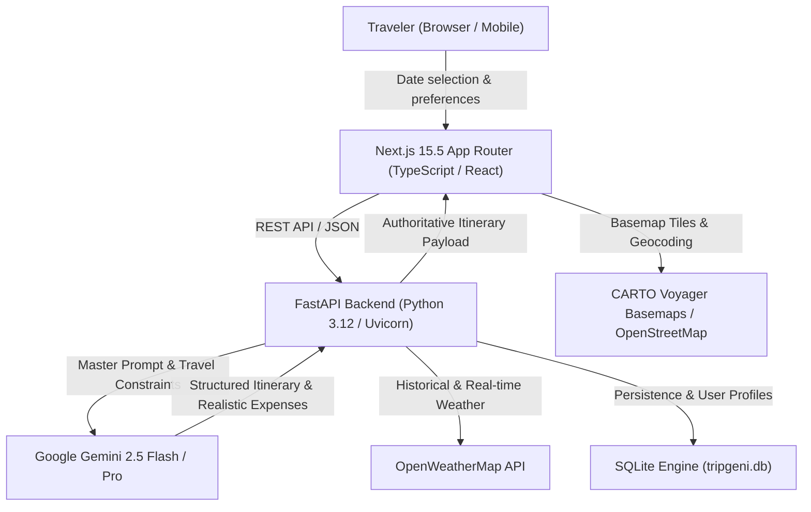

# TripGeni Architecture & System Design

## 1. System Overview
TripGeni is an intelligent AI-driven travel orchestration platform that generates real-money, day-by-day itineraries with accurate travel durations, dynamic budget allocation, live weather intelligence, and interactive geospatial route visualization.

## 2. Core Architectural Components

### A. Frontend Architecture (Next.js 15.5 App Router)
- **Directory**: `frontend/src/app`
- **Routing**: Next.js App Router with server and client components (`"use client"` for interactive wizards).
- **Core Pages**:
  - `/planner`: Multi-step intelligent trip planning wizard (Destination, Dates & Budget, Style & Transit, Accommodations & Focus).
  - `/trip/generated`: Real-time interactive itinerary dashboard with day-by-day tabs, budget donut breakdowns, and route maps.
  - `/dashboard`, `/analytics`, `/achievements`: User metrics, past trips, and expense tracking.
- **Geospatial Route Map (`TripInteractiveMap.tsx`)**:
  - Leaflet 1.9 with CARTO Voyager raster tiles.
  - Numbered circular SVG markers (`1, 2, 3...`) reflecting sequential itinerary stops.
  - "Open in Google Maps" external navigation integration.

### B. Backend Architecture (FastAPI + Pydantic v2)
- **Directory**: `backend/app`
- **FastAPI Core**:
  - `main.py`: Application factory, CORS middleware, global exception handlers, health checks.
  - `api/trip.py`: Itinerary generation, saving, updating, and history endpoints.
  - `api/auth.py`: JWT-based authentication, user registration, and profile management.
- **Intelligence & Calculation Engine**:
  - `services/ai_service.py`: Gemini prompt architecture, fallback offline generator, and expense normalization.
  - `services/tourism_rag_service.py`: Semantic vector search and RAG retrieval over verified Indian tourism dataset.
  - `services/verified_travel_data.py`: Multi-modal transit schedules (trains, flights, buses, self-drive) with realistic fare estimates.
  - `services/weather_service.py`: Real-time and seasonal weather forecasts.

## 3. Date & Transit Pacing Conventions
- **Duration**: Computed dynamically from `fromDate` and `toDate` calendar pickers (`durationDays = toDate - fromDate + 1`).
- **Transit vs. Exploration**:
  - One-way travel duration (≥ 12 hours) allocates 1 transit day each way.
  - Long multi-day rail or road trips (≥ 24 hours) allocate 2 transit days each way.
  - Destination exploration days = `Math.max(1, durationDays - (transitDays * 2))`.
  - Sightseeing activities are strictly prohibited during transit segments.
